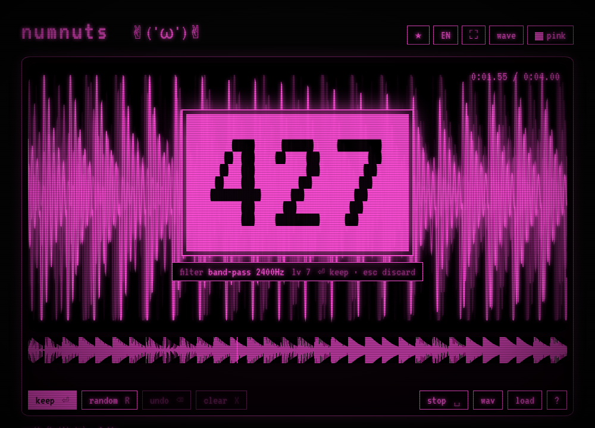

# numnuts

A fun and simple resampling app. Load an audio sample, type a 3-digit code, and hear the effect. Keep typing more codes to stack effects, then export anything cool to a WAV file.

**Try it: [nokitri.github.io/numnuts](https://nokitri.github.io/numnuts/)**

